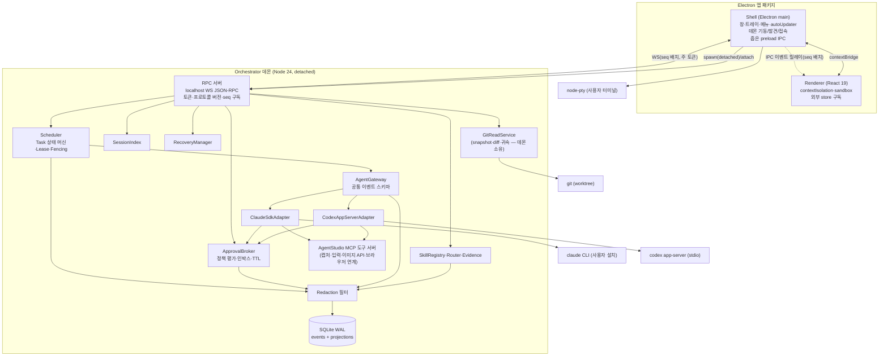

# SYSTEM_ARCHITECTURE — 시스템 아키텍처

| 메타 | 값 |
|---|---|
| 상태 | FINAL (2026-11-01) |
| 관련 | `TECH_STACK_DECISIONS.md`(구조 대안 비교·스택), ADR-0001~0008, `FINAL_ARCHITECTURE_DECISIONS.md` D3·D27 |
| UNVERIFIED | 데몬 런타임 방식(P00 S6), Windows detached 데몬 동작(P00 S5), app-server 재구독(P00 S1b) |

## 1. 프로세스 토폴로지



프로세스 3개(Shell, Renderer, 데몬) + 에이전트 자식 프로세스. 데몬은 Shell이 없어도 동작한다. **Git 읽기(스냅숏·diff·blob 해시·충돌 마커)는 데몬 소유 `GitReadService`**로 두어 Shell이 없을 때도 Verifier가 변경·테스트 증거를 확정할 수 있다. 사용자 터미널(node-pty)만 Shell(main)이 소유해 에이전트 경로와 분리한다. 사용자 터미널에서 일어난 변경은 **귀속 불명**으로 기록하고, Monaco Save처럼 앱이 관찰한 변경만 `actor=user`로 확정한다.

**RPC 접속 계약**: 데몬 WS에 접속하는 프로세스는 **main 하나**다. Renderer는 토큰·포트를 전혀 받지 않으며 네트워크 접속도 하지 않는다(CSP `connect-src 'none'` 유지). main이 키링의 주 토큰으로 데몬에 접속해 이벤트를 구독하고, preload의 좁은 IPC 채널(`events.subscribe(fromSeq)`, `rpc.read(method, params)`, `rpc.write(method, params)`)로 Renderer에 릴레이한다. 쓰기 RPC(`task.submit`, `approval.decide`)는 main이 발신 frame·창 ID를 검증한 뒤 데몬에 전달한다. 재연결은 main이 수행하고 Renderer는 `lastAppliedSeq`로 IPC 재구독만 한다. 고빈도 델타는 main에서 seq 배치로 코얼레싱(ADR-0004 외부 store).

## 2. 모듈 (깊은 모듈 원칙: 작은 인터페이스, 큰 구현)

| 모듈 | 인터페이스(작게) | 구현에 숨기는 것 | 심(seam)·어댑터 |
|---|---|---|---|
| **AgentGateway** | **정식 서명은 `packages/protocol/gateway.ts` 하나**: 이 표는 요약이며 필드 목록은 AGENT_INTEGRATION §1 코드 블록이 정본. `capabilities(agent)`, `startRun(spec: RunSpec)→RunHandle`, `listSessions(agent, filter)`, `readSession(ref)`; `RunHandle{runId, sessionRef, events(), steer(text), interrupt(), respond(requestId, answer: ApprovalAnswer\|UserInputAnswer\|ElicitationAnswer), close()}` | SDK/JSON-RPC 차이, 이벤트 정규화, 재시도·백오프, 버전 기능 감지 | 심 = 에이전트 종류. 어댑터 2개(Claude SDK, Codex app-server) + fallback 어댑터(Claude CLI stream-json, Codex exec 읽기 전용) |
| **Scheduler** | `submit(task)`, `transition(taskId, event, token)`, `acquireLease(taskId)`, `heartbeat(token)` | 상태 머신 규칙, worktree 슬롯, 반복 상한, 시간 상한(승인 대기 제외) | 심 = 저장소(`EventStore` 인터페이스). 어댑터: SQLite(실), 메모리(테스트) |
| **ApprovalBroker** | `evaluate(request)→AUTO|ASK|DENY`, `decide(requestId, decision, scope)`, `pending()` | 14행 정책 매트릭스(SECURITY_MODEL §2), 모드별 보장 수준 축소, 범위·만료, 승인 스냅숏 대비 범위 이탈 검사, TTL→BLOCKED | 심 = 정책 소스(프로젝트 정책 JSON) |
| **Journal**(= `EventStore` 인터페이스의 구현 모듈; 두 이름은 같은 것) | `append(event)→seq`, `read(from, to)`, `subscribe(fromSeq)`, `projections()` | WAL·단일 writer 큐·마스킹·보존·백업 | 어댑터: better-sqlite3(실), 메모리(테스트) |
| **GitReadService**(데몬) | `snapshot(worktree)→{head, dirty[], conflicts[], blobs}`, `diff(worktree, from, to)`, `attribute(path)→'observed'\|'linked_to_run'\|'unknown'` | git 명령 실행·파싱, 충돌 마커(`ls-files -u`, MERGE_HEAD) | 어댑터: git CLI(실), 픽스처(테스트) |
| **AgentStudio MCP 도구 서버**(REQ-CAP-08) | MCP 도구 `screen.capture`, `input.click/type`, `image.generate(provider)`, `browser.open/act` — 각 호출은 ApprovalBroker 영역(브라우저·컴퓨터 사용) 통과 | OS별 캡처·입력 구현, 공급자 API 키(키링), 마스킹 | 양 에이전트에 `mcpServers`/`-c mcp_servers.*`로 노출. 범위는 P00 S9 결과로 확정 |
| **SkillRegistry/Router/Evidence** | `scan()`, `expose(taskKind, agent, project)→{exposed[], expectedLead, support[]}`, `reconcile(observedSelection)`, `observe(runEvent)`, `verify(taskId)` | 해시·커밋 대조, 사용자 전용·보류 분류, 충돌표, 어댑터별 로드 관찰 규칙 | 심 = 스킬 저장 경로(Claude `~/.claude/skills`, Codex `$CODEX_HOME/skills`) |
| **SessionIndex** | `list(project, agent)`, `link(runId, sessionRef, role)`, `refresh()` | 공식 API 캐시, N:M 연결 | 어댑터 = Gateway 경유 |
| **RecoveryManager** | `assess()→Assessment[]`, `apply(assessmentId, choice)` | lease 회수, 효과 대조, git dirty 판정표 | — |
| **RPC** | JSON-RPC 메서드 묶음(`task.*`, `approval.*`, `session.*`, `skill.*`, `events.subscribe{fromSeq}`) | 인증 토큰, 버전 협상, 배치 | 전송 = WS(실), in-proc(테스트) |
| **Shell** | `ensureDaemon()`, `relayEvents()`, `openProject()`, `tray`, `update` | 데몬 발견(락/포트 파일), detached spawn, IPC 이벤트 릴레이·쓰기 검증, 업데이트 연기 규칙 | — |

삭제 테스트: Gateway를 지우면 두 어댑터 차이가 Scheduler·UI 전체로 퍼진다 → 깊이 있음. ApprovalBroker를 지우면 승인 정책이 어댑터마다 중복된다 → 깊이 있음.

## 3. 데이터 흐름

1. **지시 제출**: Renderer → IPC `rpc.write('task.submit')` → main 검증 → 데몬 RPC → Journal `TaskCreated` → Scheduler 큐.
2. **실행**: Scheduler lease → `SkillRouter.expose`(노출 범위·기대 주도 스킬) → Gateway `startRun` → 어댑터가 세션 시작/재개 → 이벤트 스트림 → 에이전트의 스킬 선택이 관찰되면 `SkillSelected` 기록 + 기대값 대조(사용자 명시 호출·교정 주입은 시작 시 기록).
3. **이벤트**: 어댑터 원본 → 공통 이벤트 → Redaction → Journal append(seq) → 투영 갱신 → RPC 구독자에 seq 배치 전송 → Renderer 외부 store → rAF 렌더.
4. **승인**: 어댑터 승인 요청 → ApprovalBroker.evaluate → AUTO면 즉시 응답, ASK면 `ApprovalRequested` + Task `WAITING_APPROVAL`(시간 정지) → 사용자 결정 → `ApprovalDecided` → 어댑터 콜백 resolve.
5. **외부 효과**: 파일 패치·커밋·푸시·설치 = `EffectIntent(idempotency_key)` → 실행 → `EffectCommitted`.
6. **완료**: `RunArtifacts` → Verifier(테스트·스킬 증거·AC·범위) → `VERIFYING→COMPLETED` → Checkpoint.
7. **복구**: 기동 시 RecoveryManager → 판정표 → 자동 재개/승인 대기/차단.

## 4. 프로세스 경계와 권한

| 경계 | 통제 |
|---|---|
| Renderer ↔ main | contextIsolation·sandbox·좁은 preload, IPC 발신 검증, 토큰·경로 미노출 |
| main ↔ 데몬 | localhost WS(127.0.0.1), 주 토큰(키링), 프로토콜 버전 협상, 요청별 권한 검사. **Renderer는 데몬과 직접 통신하지 않음** |
| 데몬 ↔ 에이전트 | Claude: permission mode·allow/deny·`canUseTool`; Codex: `approvalPolicy`·`sandboxPolicy(workspaceWrite, 루트=worktree)`; `--approve-for-me` 금지 |
| 에이전트 ↔ 파일 시스템 | 프로젝트 worktree 밖 쓰기는 S4 차단 시험에 합격한 OS·공급자 조합에서만 사전 차단으로 표시(후보: Codex `workspaceWrite`, Claude WSL2)하고, 나머지 조합은 정책·사후 diff 감사·경고로 처리(SECURITY_MODEL §2.1). worktree는 보안 샌드박스 아님 명시 |
| 사용자 터미널 | Shell 소유, 에이전트 접근 불가, 변경은 `actor=unknown`(터미널 외부 수정과 구분 불가) — 앱 관찰 변경(Save)만 `actor=user` |
| Renderer ↔ 데몬 | 직접 연결 없음. 읽기·구독·쓰기 전부 main IPC 릴레이, 쓰기는 main이 발신 검증 |
| 저널 | 비밀 마스킹 후 저장, 대화 원문 미저장 |

## 5. 데몬 생명주기

- **기동**: Shell이 락/포트 파일 확인 → 없으면 `spawn(daemon, {detached:true, stdio:'ignore'}).unref()` → 토큰 교환 → 접속.
- **창 닫기**: Shell은 트레이에 남고 데몬·턴 유지. **트레이 종료**: 진행 중 턴 interrupt → 세션 보존 → 데몬 종료(자식 프로세스 트리 정리).
- **재부팅**: 데몬 없음 → RecoveryManager.
- **런타임**: 동봉 Node vs Electron `runAsNode` — P00 S6에서 비교·결정(D5, ADR-0005). OS 서비스 등록은 V2.
- **OS 범위**: Windows 생명주기 실측은 Windows MVP-Core 게이트. macOS·Linux는 `detached` 의미가 다르므로 V1 게이트에서 동일한 창 종료·앱 종료·재접속·자손 정리 시험(TEST-BG-06~10)을 설치물로 반복한다.
- **업데이트**: 실행 중 Task 있으면 적용 연기.

## 6. 디렉터리 구조(안)

```
agent-studio/
├─ apps/shell/        Electron main + preload
├─ apps/renderer/     React UI
├─ apps/daemon/       Orchestrator 데몬 엔트리
├─ packages/gateway/  AgentGateway + adapters(claude-sdk, codex-app-server, fallbacks)
├─ packages/core/     Scheduler, ApprovalBroker, Journal, Recovery, Skills, SessionIndex
├─ packages/protocol/ RPC 스키마, 공통 이벤트 타입, Gateway 정식 서명(gateway.ts), task-transitions.json, app-server 생성 타입(generate-ts 산출물 고정)
├─ packages/tools-mcp/ AgentStudio MCP 도구 서버(REQ-CAP-08, V1)
├─ packages/ui-kit/   공용 컴포넌트
├─ spikes/            P00 스파이크 스크립트·픽스처
└─ docs/              planning(설계 문서), spikes(스파이크 보고서), agent-studio/<task>/ 산출물
```

## 7. 횡단 관심사

- **관측성**: 저널이 1차 로그. 데몬 프로세스 로그는 파일 롤링, 마스킹 동일.
- **버전 고정**: Claude SDK 0.3.N↔CLI 2.1.N parity 확인, Codex app-server 스키마를 CI에서 `generate-json-schema`로 생성·diff.
- **테스트 심**: Journal·EventStore 메모리 어댑터, Gateway 가짜 어댑터(녹화된 이벤트 재생)로 Scheduler·Broker 단위 테스트. 어댑터는 실제 CLI 대상 계약 테스트(Phase 00 녹화).
