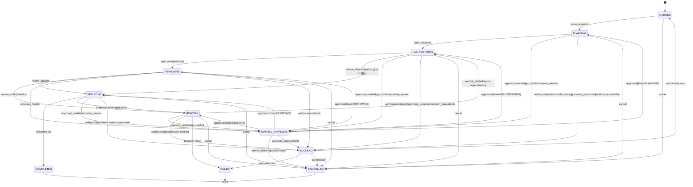

# PHASE_MANAGEMENT_DESIGN — 계층·상태 머신·재계획

| 메타 | 값 |
|---|---|
| 상태 | FINAL (2026-11-01) |
| 요구사항 | REQ-PH-01~08, REQ-STATE-01~04, REQ-SM-07, REQ-WS-13 |
| 원칙 | Task 상태는 오케스트레이터 한 곳만 기록, `COMPLETED`는 증거 필요 |

## 1. 계층과 관계

```
Workspace 1─N Project 1─N Phase 1─N Task 1─N AgentRun N─M Session
                               │
                               └─ Phase ─DAG─ Phase (depends_on)
```

| 엔티티 | 의미 | 생성 주체 | 비고 |
|---|---|---|---|
| Workspace | 사용자 1명의 앱 인스턴스(설정·전역 스킬 정책) | 앱 | 단일 |
| Project | 로컬 폴더(+Git 저장소) + 프로젝트 정책 | 사용자 | REQ-PM |
| Phase | 계획 단위. 목표·Acceptance Criteria·의존성 | 자동 생성(제안) 또는 사용자 | 세션과 1:1 아님 |
| Task | 수행 단위. 상태 머신 보유. 담당 에이전트·주도 스킬 | Phase 분해 또는 사용자 | 하나의 Task는 한 번에 하나의 활성 AgentRun |
| AgentRun | 특정 에이전트 호출 시도(turn 묶음). lease·fencing token 보유 | Scheduler | 재시도마다 새 AgentRun |
| Session | 에이전트 네이티브 대화(`claude:<uuid>`, `codex:<thread_id>`) | 어댑터 | 여러 AgentRun이 재사용·분기. 본문은 저장 안 함 |
| Checkpoint | Phase/Task 완료 시점의 git ref + 저널 seq + 세션 ID 집합 + 변경 파일 해시 | Orchestrator | Checkpoint Restore 입력 |

Phase≠Session 원칙: Phase는 사람이 읽는 계획 단위, Session은 에이전트 대화 단위. 한 Session이 여러 Phase에 걸칠 수 있고, 한 Phase가 여러 Session을 소비할 수 있다. 연결은 `agent_run_sessions(agent_run_id, session_id, role: primary|forked_from|handoff_target)`로만 표현한다.

## 2. Task 상태 머신



### 전이 규칙표

**단일 출처 원칙**: 허용 전이는 `packages/protocol/task-transitions.json`(상태 × 이벤트 → 다음 상태, 사전 조건 ID; **P01 T4 산출물 — 계획 단계에는 존재하지 않으며 아래 표가 그 초안**) 하나로 고정하고, 다이어그램은 이 파일에서 생성(`scripts/gen-transitions.ts`), CI가 문서 내 표와 diff한다. 위 다이어그램·복구표(SESSION_RECOVERY §4)·UI 액션 메뉴는 이 표에서 생성한다. 취소(`cancel`)와 승인 보류(`approval_needed`)는 **모든 비종결 상태**에서 허용된다. Git 충돌은 어디서 감지되든 `WAITING_APPROVAL(git_conflict)` 하나로만 전이한다.

| 전이 | 사전 조건 | 허용 이벤트 | 제한 시간 | 실패 처리 | 감사 기록 |
|---|---|---|---|---|---|
| QUEUED→PLANNING | Phase 의존성 전부 COMPLETED, worktree 동시 수정 슬롯 확보, lease 획득 | `lease_acquired(run_id, fencing_token)` | — | 슬롯 없으면 QUEUED 유지 | `TaskTransition` + lease 정보 |
| PLANNING→IMPLEMENTING | 계획 산출물 존재(파일 또는 저널 항목), 주도 스킬 선택 기록(`SkillSelected`) | `plan_accepted` (Auto: 자동, Manual: 사용자 승인) | 계획 단계 ≤ 작업 상한의 25% | 초과 시 WAITING_APPROVAL(사용자 확인) | 계획 해시 |
| IMPLEMENTING→REVIEWING | `RunArtifacts` 기록(변경 파일 ≥0, 테스트 결과 또는 "해당 없음" 사유), `implementer_agent` 기록 | `impl_done` | 턴 상한 20분(사전 30), 작업 활성 시간 누적 120분 | 상한 초과 → 어댑터 interrupt → REWORK 또는 BLOCKED | 변경 파일 해시 목록 |
| IMPLEMENTING→VERIFYING | 리뷰 생략 정책 충족(COLLABORATION_PROTOCOL §5 5번: 금지 범주 아님, 변경 파일 ≤2 고정 상한, 테스트 통과, 외부 효과 원장 비어 있음, `capture_confidence=complete`) | `review_skipped(policy)` | — | 조건 미충족 → REVIEWING | `ReviewSkipped{policy}` 감사 이벤트 |
| REVIEWING→VERIFYING | **모든 모드에서** `reviewer_agent ≠ implementer_agent`(같은 에이전트의 다른 세션 불인정), 리뷰 산출물 존재. Manual 모드에서 사용자가 산출물을 선택했어도 반대편 리뷰 또는 명시적 생략 판정(`ReviewSkipped{reason:user_policy}`) 필요 | `review_passed` | 턴 상한 | `review_failed` → REWORK(iteration+1, **같은 구현자 재배정**) | 리뷰 결과·심각도, 양측 agent ID |
| VERIFYING→COMPLETED | (a) 테스트·빌드 결과 기록 (b) 필수 스킬 증거 등급 ≥ Task 유형별 최소치(`APPLIED_VERIFIED` 기본; `LOAD_OBSERVED`로 충분한 Task 유형은 EVIDENCE_SPEC §5에 한정 열거) (c) Acceptance Criteria 체크 (d) 승인 범위 이탈 없음 (e) **실제 변경과 AI 보고 일치**(diff 존재 여부 비교) (f) `effects`에 `unverifiable` 없음 | `evidence_ok` | — | 미충족 → REWORK 또는 BLOCKED(iteration 초과) | 증거 ID 집합 |
| {PLANNING, IMPLEMENTING, REVIEWING, VERIFYING}→WAITING_APPROVAL(BLOCKED·CANCELLED·COMPLETED·FAILED에서는 불가) | ApprovalBroker `ASK` 판정, 또는 Git 충돌·복구 검토 | `approval_needed(request_id)` / `git_conflict` / `recovery_review` / `compare_blocked`(P09 순차 비교 되돌리기 불가) | **활성 작업 시간 정지**(`wait_ms`에 별도 누적). 승인 요청은 **15분** 후 `ApprovalExpired` → `BLOCKED(approval_expired)`(D14); git_conflict·recovery_review는 만료 없음 | 거부 시: 대체 경로 있으면 복귀, 없으면 CANCELLED. 사용자 취소 가능 | 요청 원문·판정·요청/결정/만료 시각 |
| BLOCKED(approval_expired)→QUEUED | 사용자 복귀. 만료된 네이티브 요청·턴은 **재사용 금지**; 효과별 상태 대조 → 완료 확정 단계 건너뛰기 → 남은 단계 재계획 → 새 run이 새 승인 요청 발행. 미기록 효과 의심 시 자동 재개 금지 | `unblocked(user)` | — | — | 대조 결과 |
| {QUEUED, PLANNING, IMPLEMENTING, REVIEWING, VERIFYING, WAITING_APPROVAL, REWORK}→BLOCKED(종결 상태·PAUSED 제외) | 인증·한도·네트워크·스킬 누락·복구 불확실·세션 조회 불가·승인 만료 | 각 사유 이벤트 | — | 자동 재실행 금지. 사용자 unblock·취소만 | 사유 코드 |
| REWORK→FAILED | iteration ≥ 리뷰·수정 상한(기본 3) 또는 Diff·테스트 변화 없는 반복 2회 | `iteration_exhausted` | — | 사용자 알림 | 반복 이력 |
| {QUEUED, PLANNING, IMPLEMENTING, REVIEWING, VERIFYING, WAITING_APPROVAL, BLOCKED, REWORK}→CANCELLED(종결 상태 제외) | 사용자 취소(**WAITING_APPROVAL·BLOCKED·REWORK 포함**) | `cancel` | — | 어댑터 interrupt → 세션 보존 → 변경사항은 보존(되돌리기는 별도 선택). 보류 중 승인 요청은 `decline` | — |
| 일시정지(플래그) | `tasks.paused` — 상태 전이 아님 | `PauseRequested/Paused/ResumeRequested` | 현재 턴 종료까지 대기 | Scheduler 다음 턴 배정 금지, 재기동 후 유지 | 저널 이벤트 |

불변식: (1) 전이는 데몬의 `transition()` 하나만 수행하고 fencing token이 현재 lease와 다르면 거부 (2) `COMPLETED`는 에이전트의 "완료했습니다" 텍스트로 진입 불가 (3) 모든 전이는 저널 이벤트 1건과 1:1 (4) 전이표 파일과 다이어그램의 불일치는 CI 테스트로 차단.

시계: `active_ms`(활성 턴 누적 → 작업 상한 120분), `wait_ms`(승인·일시정지 wall-clock, 상한 미차감), 턴 시간(20분 상한), lease TTL(90s)은 별도 저장. `WAITING_APPROVAL`에서 복귀한 run은 남은 `active_ms`와 호출 상한을 승계한다.

## 3. Phase 수준 상태

Phase 상태는 Task 상태의 **투영**이다: `NOT_STARTED`(모든 Task QUEUED), `IN_PROGRESS`, `BLOCKED`(하나 이상 BLOCKED/WAITING_APPROVAL), `COMPLETED`(모든 Task COMPLETED + Phase Acceptance Criteria 체크 + Checkpoint 생성), `FAILED`. Phase DAG 간선은 `depends_on`; 사이클 금지(저장 시 검증).

## 4. Phase 자동 생성·재계획 (REQ-PH-01·07)

- 자동 생성은 항상 **제안(proposal)** 상태로 생성되고 사용자가 수락하면 Phase가 된다(Auto Collaboration 모드에서는 "제안 자동 수락"을 프로젝트 정책으로 켤 수 있음).
- **사용자 편집이 권위를 가진다.** 사용자가 편집한 Phase/Task에는 `user_edited=true` 플래그가 붙고, 자동 재계획은 이 항목을 수정하지 않고 **변경 제안 Diff**(추가/삭제/의존성 변경)를 만든다.
- 요구사항 변경 이력: 저널 `RequirementChanged{req_id,before,after,source}` → 투영 `requirement_changes`(DATABASE_SCHEMA §2.2); 영향 분석은 `requirement_links`로 영향 범위를 계산해 "재검토 필요" 표시.
- 재계획 트리거: 요구사항 변경, Task FAILED, 사용자 요청. 재계획은 `PLANNING` 상태의 특수 Task(`kind=replan`)로 실행되어 동일 상태 머신·승인·증거 규칙을 따른다.

## 5. UI 연계 (REQ-WS-13)

Task 카드는 두 표시를 항상 함께 보여준다: **AI 보고 상태**(에이전트가 말한 것: "구현 완료")와 **검증 상태**(저널 기반: 변경 파일 n개, 테스트 통과/실패, 스킬 증거 등급). 둘이 불일치하면 경고 배지.

## 6. 체크포인트

| 필드 | 값 |
|---|---|
| `checkpoint_id` | ULID |
| `scope` | phase / task |
| `git_ref` | 커밋 해시 또는 worktree HEAD + dirty 여부 |
| `journal_seq` | 이 시점까지의 마지막 이벤트 |
| `sessions` | 관련 세션 ID와 마지막 turn/메시지 식별자 |
| `files` | 변경 파일 경로 + blob 해시 |
| `tests` | 마지막 테스트 결과 요약 |
| `approvals` | 유효한 승인 스냅숏 |

Checkpoint Restore는 세션 복원이 아니라 "이 시점의 사실 집합에서 새 세션으로 handoff"임을 UI에 명시한다(REQ-SM-13).
